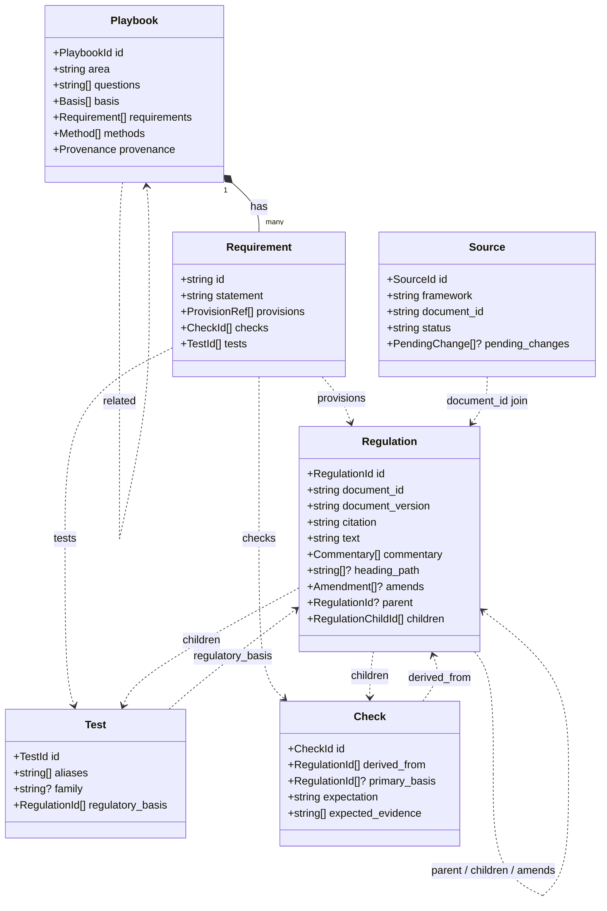
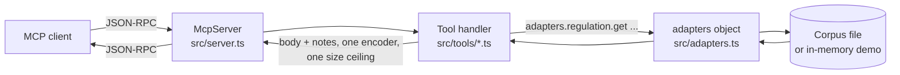

# Architecture

The surfaces and how they reference each other, the request lifecycle, where each concern lives, and the boundaries that are not negotiable.

## Surfaces

Four content surfaces and a registry that sits beside them:

| Surface | Example id | What an entry asserts |
|---|---|---|
| Regulation | `regulation://crr/178/1/a` | What the law, a guideline or a supervisory guide says, verbatim. Versioned (`document_version`, `as_of`); `commentary[]`; `heading_path`, `role`, `kind`, `obligation`; `amends` on an amending instrument's provisions |
| Test | `test://jeffreys` | A statistical test described, never run. `family` and `aliases` make variants equivalent; `acceptance_criteria` is the bar |
| Check | `check://calibration/pd/lra-derived` | A supervisory expectation with a concrete pass bar, traced to law by `derived_from` and `primary_basis`, with `expected_evidence` |
| Playbook | `playbook://pd-long-run-average` | One topic, compiled across documents: `basis` labelled by force, `requirements` with cited provisions and verbatim quotes, `methods` marked regulatory or practice, `pitfalls`, what the library does not hold |
| Source | `source://eba/gl-2017-16` | Whether a document is current: `status`, `verified`, supersession, milestones, `coverage`, `pending_changes`, `citation_style` |

The typed edges:

| From | Field | To |
|---|---|---|
| Check | `derived_from`, `primary_basis` | Regulation |
| Test | `regulatory_basis`, `primary_basis` | Regulation |
| Regulation | `parent` / `children` | Regulation (nesting), plus Check and Test |
| Regulation | `amends[].target` | Regulation of another document |
| Playbook | `basis[].provisions`, `requirements[].provisions`, `methods`, `pitfalls` | Regulation |
| Playbook | `requirements[].checks`, `requirements[].tests` | Check, Test |
| Playbook | `related` | Playbook |

Every edge is enforced at compile time by template-literal id types: `Check.derived_from: RegulationId[]` rejects a `TestId`, and `Regulation.children` rejects a `PlaybookId`. Sources sit outside this graph: nothing points at a `SourceId`, and the join to a document's provisions is `framework` + `document_id` string equality. `related` is the one computed reverse index (`src/referrers.ts`), so a check or test listed as a child of a regulation must also name it in `derived_from` / `regulatory_basis`; the linter enforces this mirror invariant.

The dashed arrows are the cross-surface references. The computed types (`CorpusInfo`, `Referrers`, the notes) are derived at query time and not stored; the [schema reference](/corpus/schemas) has every field.

## Request lifecycle

The `adapters` object is the seam. Defaults return empty, `examples/inmemory-demo.ts` seeds maps, `createFileAdapters` serves a corpus file, and a production backend reassigns the handles ([Adapters](/adapters/)). The tool layer owns paging, the size ceiling and the notes, so any adapter gets them. Ranking and the citation resolver are shared code the adapters call.

## Where things live

| Concern | File |
|---|---|
| Registration of the eight tools, the resources and the prompt | `src/server.ts` |
| One file per tool | `src/tools/{brief,playbook,topics,search,get,cite,related,sources}.ts` |
| Paging, the one size ceiling, the one encoder, `as_of` resolution | `src/tools/shared.ts` |
| Notes (the one place), pending-change plumbing | `src/tools/notes.ts`, `src/tools/pending.ts` |
| Schemas (zod and template-literal ids) | `src/schema.ts` |
| Adapter interfaces and the handle object | `src/adapters.ts` |
| Corpus-file adapters, `as_of` history, the citation resolver | `src/file-adapter.ts` |
| Ranking (BM25F) | `src/search.ts` |
| Playbook routing, rendering, verification | `src/brief.ts`, `src/render.ts`, `src/playbook-verify.ts` |
| Holdings, pending changes, amendments, placeholders (one definition each) | `src/holdings.ts`, `src/pending.ts`, `src/amendments.ts`, `src/placeholders.ts` |
| The language rule | `src/language.ts` |
| The corpus linter | `src/validate.ts` |
| Context-quality invariants | `evals/` |

`src/schema.ts` is upstream of everything; changes there ripple by design.

## The language rule

A model repeats what the server tells it to the person it is answering, so text that talks about plumbing turns an answer about regulation into a description of a tool. Server-authored text never uses the terms in `src/language.ts` (`BANNED_TERMS`: corpus, ingest, registry, record, holdings, adapter, served, "this server"); the only self-reference is "this library". Text addressed to the model (instructions, tool and field descriptions) may name tools and fields; text meant to be repeated to the user (every note) contains no identifier at all. Eval I17 enforces it on every reply.

## Boundaries

**Read-only.** There is no write tool. Mutating the corpus belongs to the editorial process that produces it, not to the runtime that serves it: a server that could both serve and edit a provision would make every consumer ask which version it is getting.

**No execution.** The server describes a Hosmer-Lemeshow test (what it measures, what bar applies, what law backs it) and never runs one. Execution needs bank-confidential portfolio data under separate access controls, and does not belong in a knowledge-serving process.

**Playbooks are compiled elsewhere.** The factory compiles one per topic and the verifier in `src/playbook-verify.ts` checks it (a quote the provision does not say, a provision named in prose but not cited, a member provision silently dropped, practice presented as a requirement); this repository only verifies and renders. Synthesis at query time, under a context budget, was the measured failure that motivated 1.0 ([design](/design/1.0)).

**Versioning only on regulation.** Everything else serves the latest; a source's supersession is a `status` plus a `superseded_by` pointer, not history.

**Ids are stable and survive being written down.** Path segments follow the document's structure (`regulation://crr/178/1/a`; truncate it to get the article). Characters outside letters, digits and `: / . _ -` are a linter error, because ids are copied into prose and a truncated id reads as "no such record". A national transposition or a supervisor's reading is a `commentary` entry on the provision, attributed to its source, or a new framework slug; the EU text stays the base.

**Extending the schema.** A new surface means deciding which fields may reference it and widening those typed arrays on purpose; never widen an id type to `string`. A registry-shaped surface follows `Source`: outside the reference graph, joined by identity.

**Licensing.** Server code is AGPL-3.0-only; the corpus is data read at runtime, proprietary and licensed separately. The server ships only stdio, so a hosted deployment is a modified work and the licence reaches its transport, auth and metering layer.
